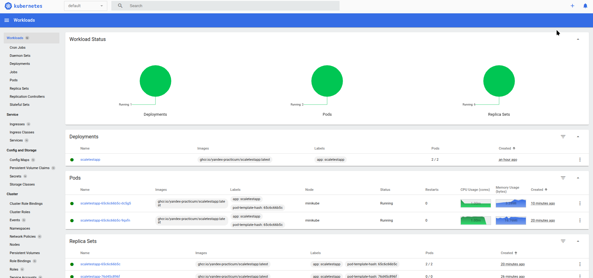
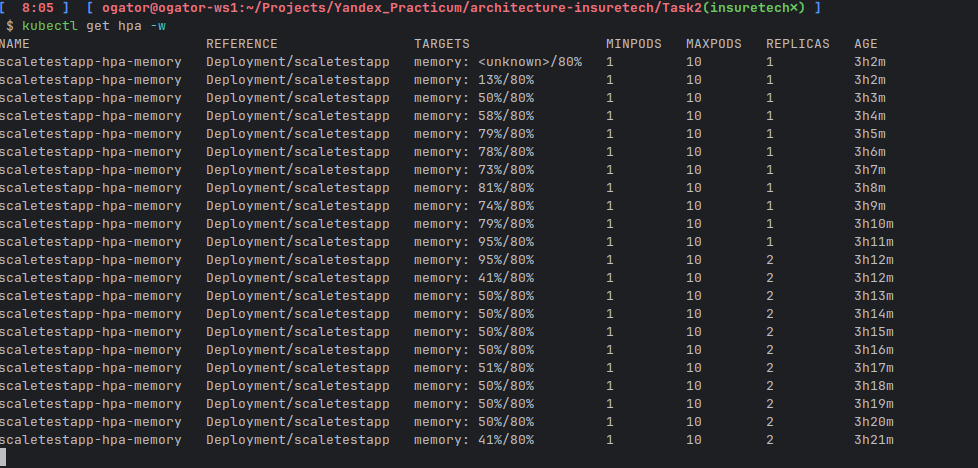
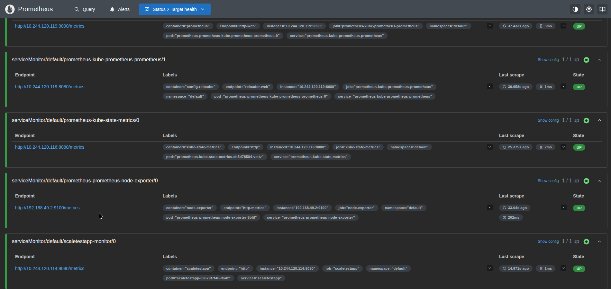
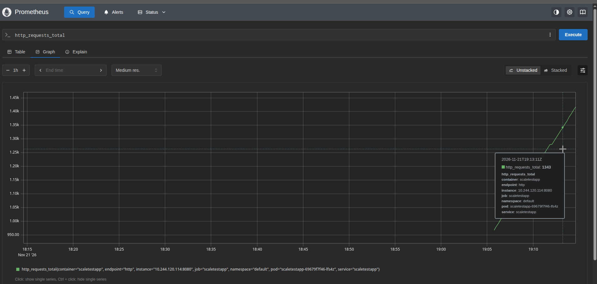
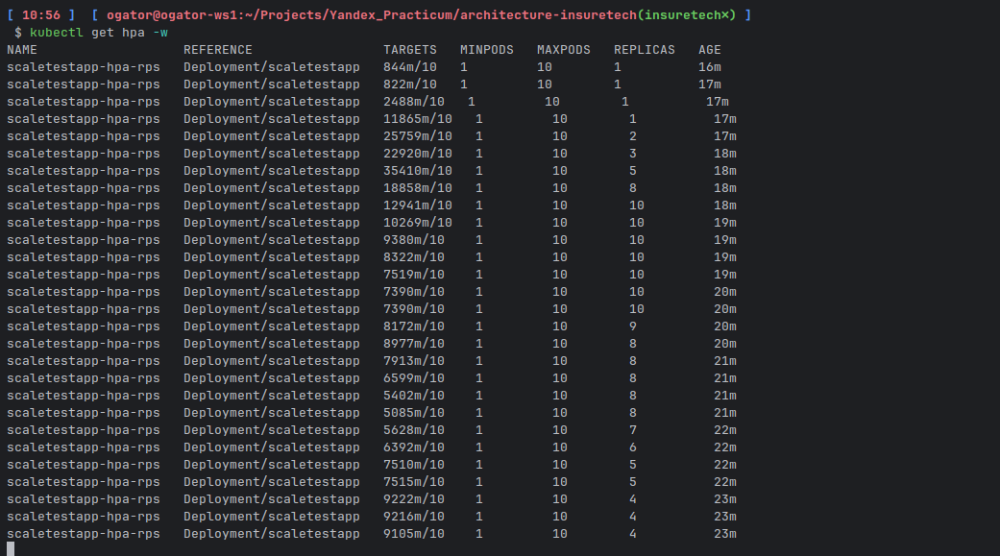
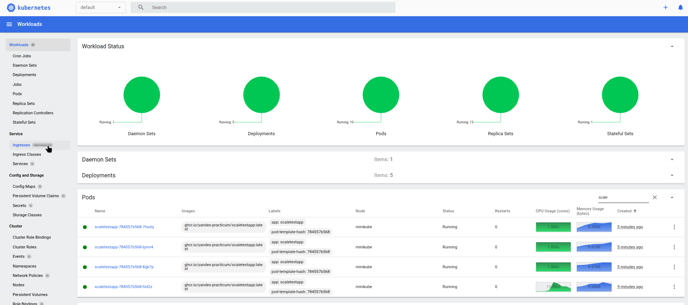

# Задание 2. Динамическое масштабирование контейнеров

## Цель

Настроить автоматическое масштабирование приложения в Kubernetes с помощью Horizontal Pod Autoscaler (HPA):
1. По утилизации памяти (memory)
2. По кастомной метрике RPS (requests per second) через Prometheus

---

## Часть 1. Масштабирование по утилизации памяти

### Шаг 1: Запуск Minikube

```bash
# Запустить Minikube с достаточными ресурсами
minikube start --cpus=4 --memory=4096

# Включить metrics-server для сбора метрик CPU/Memory
minikube addons enable metrics-server

# Проверить статус
minikube status
kubectl get nodes
```

### Шаг 2: Развернуть приложение

```bash
# Применить манифесты
kubectl apply -f deployment.yaml
kubectl apply -f service.yaml

# Проверить развертывание
kubectl get deployments
kubectl get pods
kubectl get services

# Получить URL сервиса
minikube service scaletestapp --url
```

Приложение предоставляет два эндпоинта:
- `GET /` - получение идентификатора пода
- `GET /metrics` - метрики в формате Prometheus

### Шаг 3: Настроить HPA по памяти

```bash
# Применить HPA манифест
kubectl apply -f hpa-memory.yaml

# Проверить HPA
kubectl get hpa
kubectl describe hpa scaletestapp-hpa-memory
```

**Конфигурация HPA:**
- minReplicas: 1
- maxReplicas: 10
- target: 80% утилизации памяти
- memory limit: 30Mi

### Шаг 4: Генерация нагрузки с Locust

```bash
# Установить Locust (если еще не установлен)
pip install locust

# Запустить Locust
locust -f locustfile.py

# Открыть Web UI Locust
# http://localhost:8089
```

**Параметры тестирования:**
- Host: URL из `minikube service scaletestapp --url`
- Number of users: 2000-2200
- Spawn rate: 10 users/sec
- Длительность: 5-10 минут

### Шаг 5: Мониторинг масштабирования

```bash
# Наблюдать за изменением количества реплик
kubectl get hpa -w

# Открыть Kubernetes Dashboard
minikube dashboard
```

## Результаты тестирования — Часть 1

### Скриншоты

#### Kubernetes Dashboard — метрики памяти и подов


#### HPA — лог масштабирования


### Наблюдения

**Проблема: нагрузка не распределяется между подами**

Вся нагрузка шла на первый под (~17Mi), второй оставался почти пустым (~3Mi).

Причина: kube-proxy балансирует на уровне TCP-соединений (L4), а Locust использует persistent HTTP keep-alive соединения. Одна виртуальная сессия Locust держит одно TCP-соединение на весь тест, и оно всегда попадает на один и тот же под.

Попытки исправить:
1. Добавлен заголовок `Connection: close` — сервер игнорирует
2. Отключён connection pool в Locust (`pool_maxsize=1`) — приложение на Go держит соединения на своей стороне

Правильное решение для production: использовать **Ingress с nginx/traefik** (балансировка L7 по запросам, а не по соединениям) или **Service Mesh (Istio)**.

Для целей задания факт неравномерного распределения не влияет на корректность работы HPA — он считает **среднюю** утилизацию по всем подам и масштабирует на её основе.


---

## Часть 2. Масштабирование по RPS (Prometheus)

### Шаг 1: Установить Prometheus Stack

```bash
# Добавить Helm репозиторий
helm repo add prometheus-community https://prometheus-community.github.io/helm-charts
helm repo update

# Установить kube-prometheus-stack
helm install prometheus prometheus-community/kube-prometheus-stack \
  -f prometheus-values.yaml

# Проверить установку
kubectl get pods | grep prometheus
kubectl get svc | grep prometheus
```

### Шаг 2: Настроить сбор метрик из приложения

```bash
# Применить ServiceMonitor
kubectl apply -f servicemonitor.yaml

# Проверить ServiceMonitor
kubectl get servicemonitor
kubectl describe servicemonitor scaletestapp-monitor
```

### Шаг 3: Проверить метрики в Prometheus

```bash
# Port-forward Prometheus UI
kubectl port-forward svc/prometheus-kube-prometheus-prometheus 9090:9090

# Открыть в браузере
# http://localhost:9090
```

**В Prometheus UI проверить:**

1. **Status → Targets**
   - Найти `scaletestapp` в списке targets
   - Status должен быть `UP`

2. **Graph**
   - Выполнить запрос: `http_requests_total`
   - Должны быть видны метрики с лейблами pod, namespace

3. **Запрос для RPS:**
   ```promql
   rate(http_requests_total[1m])
   ```

### Шаг 4: Установить Prometheus Adapter

```bash
# Установить Prometheus Adapter для кастомных метрик
helm install prometheus-adapter prometheus-community/prometheus-adapter \
  -f prometheus-adapter-values.yaml

# Проверить доступность кастомных метрик
kubectl get apiservices | grep custom.metrics

# Проверить конкретную метрику
kubectl get --raw "/apis/custom.metrics.k8s.io/v1beta1/namespaces/default/pods/*/http_requests_per_second" | jq .
```

### Шаг 5: Применить HPA для RPS

```bash
# Сначала удалить HPA по памяти (чтобы не конфликтовали)
kubectl delete hpa scaletestapp-hpa-memory

# Применить HPA по RPS
kubectl apply -f hpa-rps.yaml

# Проверить HPA
kubectl get hpa
kubectl describe hpa scaletestapp-hpa-rps
```

**Конфигурация HPA:**
- minReplicas: 1
- maxReplicas: 10
- target: 10 requests/sec на под
- метрика: `http_requests_per_second`

### Шаг 6: Генерация нагрузки

```bash
# Запустить Locust (если еще не запущен)
locust -f locustfile.py

# Web UI: http://localhost:8089
```

**Параметры для тестирования RPS:**
- Number of users: 100-500
- Spawn rate: 10-20 users/sec

### Шаг 7: Мониторинг

```bash
# Наблюдать за HPA
kubectl get hpa -w

# Смотреть значение метрики
kubectl get --raw "/apis/custom.metrics.k8s.io/v1beta1/namespaces/default/pods/*/http_requests_per_second" | jq .

# Смотреть поды
kubectl get pods -w
```

## Результаты тестирования — Часть 2

### Скриншоты

#### Prometheus — Target UP


#### Prometheus — метрики http_requests_total


#### HPA — масштабирование по RPS


#### Kubernetes Dashboard — активные реплики


### Логи HPA

Полный лог: [`hpa-rps-describe.txt`](hpa-rps-describe.txt)


## Созданные файлы

### Обязательные манифесты:
- `deployment.yaml` - Deployment приложения
- `service.yaml` - Service для доступа
- `hpa-memory.yaml` - HPA по памяти
- `locustfile.py` - Сценарий нагрузочного тестирования

### Дополнительные манифесты (Часть 2):
- `prometheus-values.yaml` - Конфигурация Prometheus
- `servicemonitor.yaml` - Сбор метрик из приложения
- `prometheus-adapter-values.yaml` - Конфигурация Adapter
- `hpa-rps.yaml` - HPA по RPS
